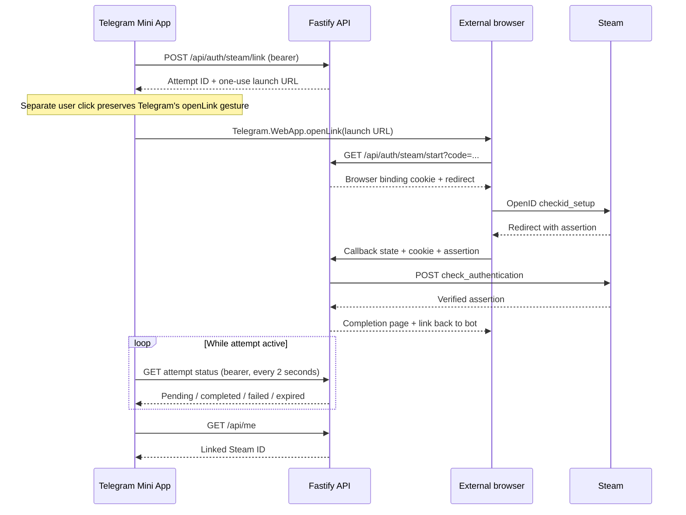

# M2 authentication and Steam handoff

## Telegram

The bot launches the Mini App in a private chat. The client sends **raw** `Telegram.WebApp.initData` to `POST /api/auth/telegram`. The server rejects duplicate fields, checks Telegram's bot-token HMAC with constant-time comparison, and requires an auth date no older than five minutes (30 seconds of future clock skew allowed). All decoded fields except `hash`, including Telegram's optional `signature`, are included without reserializing user JSON. See [Telegram's validation protocol](https://core.telegram.org/bots/webapps#validating-data-received-via-the-mini-app).

Successful verification creates/updates a user with Telegram ID and current username, then issues a random 256-bit bearer token valid for one hour. The database stores only its SHA-256 hash and expiry. No `initData`, Telegram names, date of birth, or raw session token is persisted. The Mini App keeps its token in memory; reopening it obtains a new session. `/api/me`, onboarding, link creation and status polling check the token's expiry and current ban status. Logout removes the session. Redis-backed rate limits protect authentication and public linking endpoints; liveness remains available during an outage.

Signed `initData` can be reused within its short freshness window; the API does not claim Telegram offers a globally unique one-use login nonce. Rate limits and short-lived sessions bound this behavior. Steam linking credentials are single-use.

## Onboarding and contacts

Before linking Steam, the user must confirm the configured minimum age (18 by default), accept the current rules version, and have a Telegram username. Store the confirmation timestamp and minimum/version, never a birthday. The rules prohibit harassment, cheats, spam, and publishing other users' contacts without permission. Activity sharing is an explicit option, disabled by default.

If the username is absent, show Telegram settings instructions and a **Check again** action. `POST /api/me/telegram/refresh` queries Telegram's `getChat` on the server and verifies the returned chat ID, so a client cannot invent a username. Users must start the bot first. Fresh signed Telegram login also updates or clears a changed username.

M6 must recheck usable contacts when accepting requests: usernames can disappear later. A request must not be reported as contacts-delivered until both recipients are reachable and both contacts exist. M2 implements the username-required onboarding policy; contact exchange is intentionally deferred to M6.

## Steam outside the Telegram WebView

The launch URL lives for ten minutes by default. The authenticated client creates it, then presents a separate **Open Steam** button so `openLink` executes during a fresh user gesture. An ordinary external-browser anchor is the fallback. The Mini App polls every two seconds with its bearer token, stops at terminal status or expiry, and resumes checking when visible. Reopening the Mini App reads the durable account state even when the in-memory attempt was lost.

Starting the link atomically consumes its start code and creates separate random callback state and browser-binding values. Only their hashes are stored. The binding cookie is HttpOnly, SameSite=Lax and Secure under HTTPS. The database's `returnTo` holds the callback base and attempt ID **without the raw state**. The callback hashes its incoming state before rebuilding the exact signed return URL. A callback in another browser is rejected without consuming the legitimate attempt.

The Steam provider and outbound verification URL are pinned to Valve. The server requires matching canonical claimed/identity IDs, the OpenID namespace/mode, all required signed fields, exact return URL, a recent response nonce, and an exact positive response from Steam. Redirects, oversized responses, timeouts, and malformed responses fail closed. This is a Steam-specific trust binding, not a generic arbitrary-provider OpenID library. See [Valve's provider/SteamID contract](https://steamcommunity.com/dev) and [OpenID assertion verification](https://openid.net/specs/openid-authentication-2_0.html#verification).

A callback moves STARTED → VERIFYING exactly once before contacting Steam. Completion locks the user's row, rechecks eligibility and TTL, then atomically stores the globally unique nonce, unique Steam account ownership and COMPLETED status. New attempts use the same user lock and supersede older active attempts. The API rejects replacing an existing account; a Steam ID cannot transfer to a different Telegram user. There are no Steam/FACEIT password fields or session-token storage.

The completion page links to `https://t.me/<bot>?start=steam_linked`; the bot offers the Mini App button again. Polling is the authoritative result. Cancelled, rejected, unavailable, expired or conflicting attempts show translated guidance and allow a fresh attempt.

## API surface

| Method/path | Access | Result |
| --- | --- | --- |
| `POST /api/auth/telegram` | Fresh signed initData | Token, expiry, own user |
| `GET /api/me` | Bearer | Own identity/onboarding status |
| `POST /api/onboarding` | Bearer | Confirm age/rules, locale and activity consent |
| `POST /api/me/telegram/refresh` | Bearer | Current username from Telegram |
| `POST /api/auth/logout` | Bearer | Revoke current session, 204 |
| `POST /api/auth/steam/link` | Bearer + onboarding | One-use launch URL |
| `GET /api/auth/steam/links/:id` | Owning user's bearer | Attempt status |
| `GET /api/auth/steam/start` | One-use start code | Cookie + Valve redirect |
| `GET /api/auth/steam/callback` | State + browser cookie + Valve assertion | Translated browser result |
| `GET /health` | Public | Process liveness |
| `GET /ready` | Public | DB/cache readiness |

API logs deliberately omit request URLs and auth payloads. The supplied nginx log format uses `$uri` without query strings; configure the outer HTTPS proxy likewise. Never retain callback query strings or one-time launch URLs in analytics.

## Validation and limits

Unit tests exercise Telegram HMAC/freshness and Steam assertion/network parsing. PostgreSQL integration tests use injected provider responses to exercise actual DB transactions, hash-only storage, expiry, cancellation, browser binding, ownership, nonce replay, bans, and races. Mini App tests cover in-memory sessions, external handoff, polling and resume.

These tests do **not** constitute a live Telegram/Steam sign-in. Run the real-device checklist in the README with your own bot and HTTPS tunnel before release. No API keys or actual Steam identity are needed for automated tests. FACEIT and owned-game stats are M3; Steam linking alone does not imply cached stats are available.
